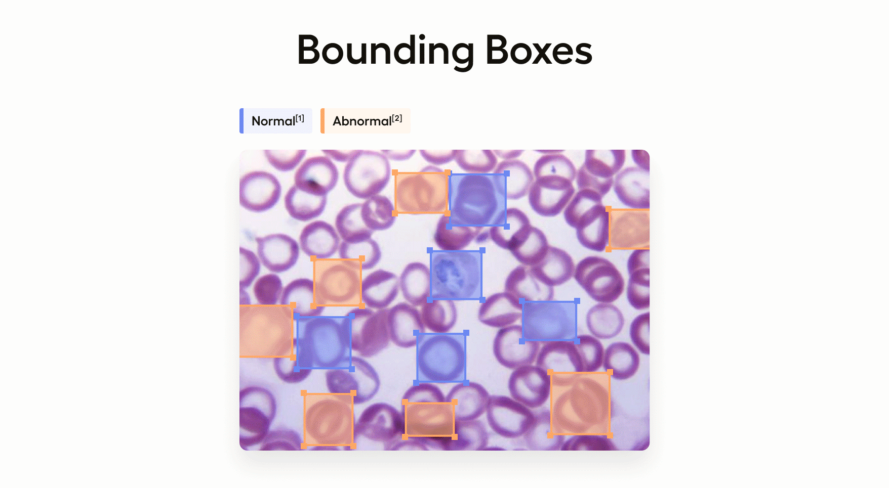
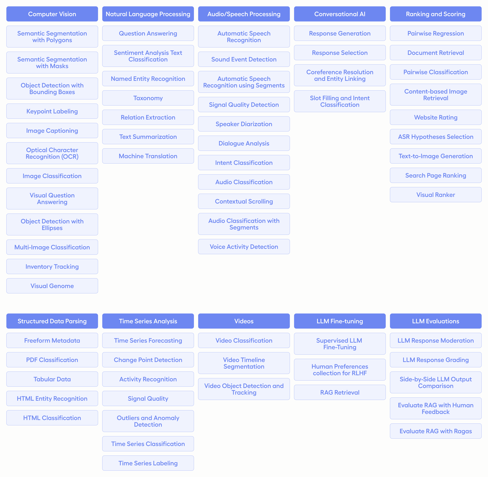

  

[English](README.md) | 简体中文

[官网](https://labelstud.io/) • [文档](https://labelstud.io/guide/) • [加入 Slack 社区 ](https://slack.labelstud.io/?source=github-1)


## Label Studio 是什么？

<!-- <a href="https://labelstud.io/blog/release-130.html"></a> -->

Label Studio 是一款开源数据标注工具。它提供简洁直观的界面，支持对音频、文本、图像、视频、时间序列等多种数据类型进行标注，并可导出为多种模型训练格式。可用于原始数据准备或已有训练数据优化，从而训练出更准确的机器学习模型。

- [试用 Label Studio](#试用-label-studio)
- [Label Studio 提供哪些能力](#label-studio-提供哪些能力)
- [内置的标注模板](#内置的标注模板)
- [使用 Label Studio 接入机器学习模型](#使用-label-studio-接入机器学习模型)
- [将 Label Studio 集成到你的现有工具中](#将-label-studio-集成到你的现有工具中)
- [升级说明（CSGHub 内置版本）](#升级说明csghub-内置版本)



有自定义数据集？你可以按自己的需求定制 Label Studio。了解更多请阅读[介绍博文](https://towardsdatascience.com/introducing-label-studio-a-swiss-army-knife-of-data-labeling-140c1be92881)。

## 试用 Label Studio

可将 Label Studio 安装到本地，或部署到云实例。[也可以注册试用 Starter Cloud 版本！](https://humansignal.com/platform/starter-cloud/)各版本功能对比详见[这里](https://labelstud.io/guide/label_studio_compare)。

- [使用 Docker 在本地安装](#使用-docker-在本地安装)
- [使用 Docker Compose 运行（Label Studio + Nginx + PostgreSQL）](#使用-docker-compose-运行label-studio--nginx--postgresql)
- [使用 pip 在本地安装](#使用-pip-在本地安装)
- [使用 poetry 在本地安装](#使用-poetry-在本地安装)
- [使用 Anaconda 在本地安装](#使用-anaconda-在本地安装)
- [本地开发环境安装](#本地开发环境安装)
- [部署到云实例](#部署到云实例)

### 使用 Docker 在本地安装
官方 Label Studio Docker 镜像在[这里](https://hub.docker.com/r/heartexlabs/label-studio)，可通过 `docker pull` 下载。
在 Docker 容器中运行 Label Studio，并通过 `http://localhost:8080` 访问。


```bash
docker pull heartexlabs/label-studio:latest
docker run -it -p 8080:8080 -v $(pwd)/mydata:/label-studio/data heartexlabs/label-studio:latest
```
所有生成的资源（包括 SQLite3 数据库文件 `label_studio.sqlite3` 和上传的文件）都存放在 `./mydata` 目录中。

#### 覆盖默认的 Docker 启动参数
可以在启动命令后追加新参数来覆盖默认行为：
```bash
docker run -it -p 8080:8080 -v $(pwd)/mydata:/label-studio/data -e CSGHUB_ENDPOINT= http://opencsg.com  heartexlabs/label-studio:latest label-studio --log-level DEBUG
docker run -it -p 8080:8080 -v $(pwd)/mydata:/label-studio/data heartexlabs/label-studio:latest label-studio --log-level DEBUG
```

#### 使用 Docker 构建本地镜像
如需构建本地镜像，执行：
```bash
docker build -t heartexlabs/label-studio:latest .
```

### 使用 Docker Compose 运行
Docker Compose 脚本提供了可直接用于生产环境的组件栈，包括：

- Label Studio
- [Nginx](https://www.nginx.com/) — 代理 Web 服务器，用于加载各种静态数据（上传的音频、图片等）
- [PostgreSQL](https://www.postgresql.org/) — 生产级数据库，替代性能较差的 SQLite3

从 `http://localhost` 开始使用，执行以下命令启动：
```bash
docker-compose up
```

### 使用 Docker Compose + MinIO 运行
还可以附加一个 MinIO 服务器作为本地 S3 存储来运行。当你想在本地系统上测试 S3 存储行为时，这种方式尤其有用。以这种方式启动 Label Studio，执行以下命令：
````bash
# 如果你不是 docker 组成员，在 Linux 上需要加 sudo
docker compose -f docker-compose.yml -f docker-compose.minio.yml up -d
````
如果你没有静态 IP 地址，必须在 hosts 文件中添加一条记录，让 Label Studio 和浏览器都能访问 MinIO 服务器。更详细的说明请参阅[数据存储指南](docs/source/guide/storedata.md)。


### 使用 pip 在本地安装

```bash
# 需要 Python >=3.8
pip install label-studio

# 启动服务，访问 http://localhost:8080
label-studio
```

### 使用 poetry 在本地安装

```bash
### 安装 poetry
pip install poetry

### 创建 poetry 环境
poetry new my-label-studio
cd my-label-studio
poetry add label-studio

### 激活 poetry 环境
poetry shell

### 启动服务，访问 http://localhost:8080
label-studio
```

### 使用 Anaconda 在本地安装

```bash
conda create --name label-studio
conda activate label-studio
conda install psycopg2
pip install label-studio
```

### 本地开发环境安装

无需从 pypi 安装软件包，即可在本地运行最新版本的 Label Studio。

```bash
# 安装全部依赖
pip install poetry
poetry install
# 执行数据库迁移
python label_studio/manage.py migrate
python label_studio/manage.py collectstatic
# 以开发模式启动服务，访问 http://localhost:8080
python label_studio/manage.py runserver
```

### 部署到云实例

可以在 Heroku、Microsoft Azure 或 Google Cloud Platform 上一键部署 Label Studio：

<a href="https://www.heroku.com/deploy?template=https://github.com/HumanSignal/label-studio/tree/heroku-persistent-pg"></a>
[](https://portal.azure.com/#create/Microsoft.Template/uri/https%3A%2F%2Fraw.githubusercontent.com%2Fhumansignal%2Flabel-studio%2Fdevelop%2Fazuredeploy.json)
[](https://deploy.cloud.run)


#### 应用前端变更

关于更新前端的说明，参见 [label-studio/web/README.md](https://github.com/HumanSignal/label-studio/blob/develop/web/README.md#installation-instructions)。


#### 在 Windows 上安装依赖
要在 Windows 上运行 Label Studio，请从 [Gohlke builds](https://www.lfd.uci.edu/~gohlke/pythonlibs) 下载并安装以下 wheel 包，以确保使用正确版本的 Python：
- [lxml](https://www.lfd.uci.edu/~gohlke/pythonlibs/#lxml)

```bash
# 升级 pip
pip install -U pip

# 如果你在 Win64 上使用 Python 3.8，安装从 Gohlke 下载的包：
pip install lxml‑4.5.0‑cp38‑cp38‑win_amd64.whl

# 安装 label studio
pip install label-studio
```

### 运行测试套件
将测试依赖加入本地安装环境：

```bash
poetry install --with test
```

也可以在预装测试依赖的 Docker 容器中运行单元测试：


```bash
make build-testing-image
make docker-testing-shell
```

无论哪种方式，运行单元测试的命令如下：

```bash
cd label_studio

# sqlite3
DJANGO_DB=sqlite DJANGO_SETTINGS_MODULE=core.settings.label_studio pytest -vv

# postgres（假设使用默认的 postgres 用户、数据库、密码；在 Docker
# 测试容器中需要额外配置才能使用）
DJANGO_DB=default DJANGO_SETTINGS_MODULE=core.settings.label_studio pytest -vv
```

## Label Studio 提供哪些能力

https://github.com/user-attachments/assets/525ad5ff-6904-4398-b507-7e8954268d69

- **多用户标注**：注册登录后即可标注，每条标注都与你的账号关联。
- **多项目支持**：在一个实例中管理你的所有数据集。
- **精简的设计**：让你专注于标注任务本身，而不是学习软件的使用。
- **可配置的标注格式**：自定义可视化界面，满足特定的标注需求。
- **支持多种数据类型**：包括图像、音频、文本、HTML、时间序列和视频。
- **从文件或云存储导入**：支持 Amazon AWS S3、Google Cloud Storage，以及 JSON、CSV、TSV、RAR、ZIP 归档文件。
- **与机器学习模型集成**：可视化并对比不同模型的预测结果，并进行预标注。
- **嵌入你的数据流水线**：REST API 让它轻松成为你流水线的一部分。

## 内置的标注模板

Label Studio 内置了多种标注模板，你也可以使用专门设计的配置语言创建自己的模板。最常见的标注模板和使用场景包括：



## 使用 Label Studio 接入机器学习模型

通过 Label Studio Machine Learning SDK 接入你喜欢的机器学习模型，步骤如下：

1. 启动你自己的机器学习后端服务。参见[更详细的说明](https://github.com/HumanSignal/label-studio-ml-backend)。
2. 在项目设置中的模型页面，将 Label Studio 连接到该服务。

这样你就可以：

- 使用模型预测对数据进行**预标注**。
- 进行**在线学习**，在标注产生的同时重新训练模型。
- 进行**主动学习**，只标注数据中最复杂的样本。

## 将 Label Studio 集成到你的现有工具中

你可以将 Label Studio 作为机器学习工作流中的独立环节使用，也可以把它的前端或后端集成到你现有的工具中。

## 生态

| 项目 | 说明 |
|-|-|
| label-studio | 服务端，以 pip 包形式分发 |
| [前端库](web/libs/editor/) | Label Studio 前端库，使用 React 构建界面、mobx-state-tree 进行状态管理。 |
| [Data Manager 库](web/libs/datamanager/) | 数据探索工具 Data Manager 的库。 |
| [label-studio-converter](https://github.com/HumanSignal/label-studio-sdk/tree/master/src/label_studio_sdk/converter) | 将标签转换为你所用机器学习库的格式 |
| [label-studio-transformers](https://github.com/HumanSignal/label-studio-transformers) | 与 Label Studio 对接的 Transformers 库 |

## 升级说明

从旧版本（如 CSGHub 2.4.0 内置的 Label Studio）迁移或升级到 2.7 及以上版本时，如果媒体文件是通过复制 `upload/` 目录带过来的（未经过页面上传），磁盘上会存在媒体文件、但数据库 `data_import_fileupload` 表中缺少对应的 `FileUpload` 登记记录。此时历史项目的图片等本地媒体将无法正常展示（旧版本会返回 500，修复后返回 404，详见 [Issue #58](https://github.com/OpenCSGs/label-studio/issues/58)）。

针对这种情况，本版本提供了存量文件补建命令。升级完成后执行：

```bash
# 1. 先预览将要补建的记录（不写数据库）
python label_studio/manage.py backfill_fileupload --dry-run

# 2. 确认输出无误后，执行补建
python label_studio/manage.py backfill_fileupload
```

说明：

- 不加参数会处理 `MEDIA_ROOT/upload/` 下所有项目目录；可用 `--project <id>` 只处理单个项目。
- 命令是幂等的：已存在登记记录的文件会自动跳过，可以重复执行。
- 补建的记录归属人为对应项目的创建者（`project.created_by`）；权限校验基于项目权限，与记录归属人无关。
- 若目录缺少对应的 `Project` 记录（如已删除项目的残留目录），命令会打印 warning 并跳过，不会中断。

## 引用

在你的文章的 **References** 部分加入 Label Studio 的引用信息：

```tex
@misc{Label Studio,
  title={{Label Studio}: Data labeling software},
  url={https://github.com/HumanSignal/label-studio},
  note={Open source software available from https://github.com/HumanSignal/label-studio},
  author={
    Maxim Tkachenko and
    Mikhail Malyuk and
    Andrey Holmanyuk and
    Nikolai Liubimov},
  year={2020-2025},
}
```

## 许可证

本软件基于 [Apache 2.0 LICENSE](/LICENSE) 授权 © [Heartex](https://www.heartex.com/)。2020-2025


